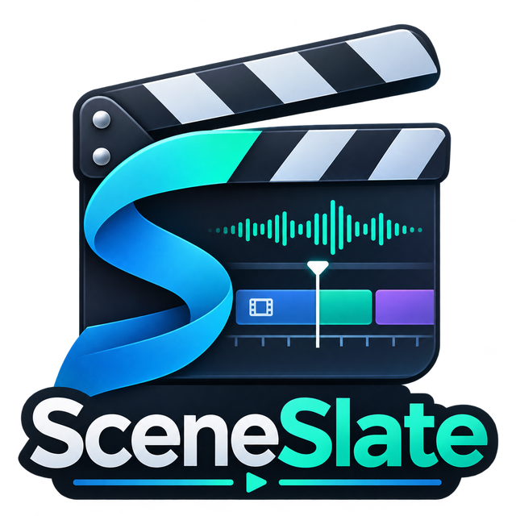

# SceneSlate 3.11.1



SceneSlate is a **cross-platform footage catalog** written in Python 3 and Tkinter. Its interface is available in **English and Italian**. A new installation starts in **English**; change the language using the **Language / Lingua** selector in the top toolbar. The preference survives restarts and upgrades, and switching languages does **not** rename files, modify a catalog or reset the scene selection.

Footage is organized as **scene → shot → optional sub-shot → take**. Every take has an optional video reference and an optional audio reference, each with independent ratings (`B` good, `R` reserve, `S` reject). Takes can have descriptions and annotations; scenes, shots and sub-shots have optional descriptions. **Original media files are never renamed, moved, deleted or duplicated.** When a video/audio pair is complete, SceneSlate attempts **background waveform synchronization** if FFmpeg is installed; the alignment metadata is stored per take, never written into the media.

## 3.11.1 — Quick review starts at shared sound

Quick review (P) scans the overlapping audio interval in bounded chunks and starts near the first significant activity present in both tracks, with 100 ms of pre-roll. Adaptive per-track energy thresholds reject silence and steady background. If no useful shared activity is detected, open the full editor; the proposed offset is not changed by this listening heuristic.

## 3.11.0 — Fast review and reverse navigation

- Select a paired take and press **P** or **Quick review (P)** to hear the proposed offset immediately. Confirm directly, open the full editor, or close without changes. Approval in the full editor also saves without another confirmation dialog.
- Right-click a file in either browser and open **File assignments**: linked occurrences share a group number, independent assignments are marked separately. Selecting an occurrence jumps to its exact scene, shot, sub-shot and take, with the correct media side active. Filters are cleared only when needed to reveal a hidden destination.
- Less frequent take commands are in **Take actions…**; copy/paste buttons are compact and explanatory text is moved to hover hints.
- Sync now checks independent frequency-band delay peaks and retries sparse matches in shorter windows. Additional acceptance paths require a tight, temporally separated consensus with a distinctive global match. Old automatic REVIEW/KO results are reprocessed; manually verified and existing valid OK offsets remain unchanged. Actual performance depends on source recordings; a score is not a probability.

## 3.10.1 — Playback and review fixes

- **Clear content…** in the scene/shot/sub-shot context menu removes takes from the selected subtree and linked equivalents after confirmation, preserving node descriptions, hierarchy, link groups and original media; Undo restores the catalog.
- Flat scene/shot/sub-shot list, with no expandable groups; scene and shot rows remain selectable for editing and linking.
- Mouse wheel scrolling in the link selector. Persistent context menus in the video browser and take list provide playback and player settings. Windows external playback restores the normal DLL search directory before launching.
- Robust fine-offset clustering and globally corroborated promotion of REVIEW to OK, with competing offsets and strong contradictory evidence still checked. Previous automatic REVIEW/KO entries are retried; manual and existing OK alignments are preserved. Real-world false-positive rates remain unmeasured.

## 3.10.0 — Faster navigation and spectral synchronization

- Play a catalogued video with Enter/F4 or double-click the video cell; F4 previews a video in the file browser without attaching it. Tools → Video player… chooses an executable, or Use system video player restores OS defaults. The choice is saved per user.
- Space toggles playback in the Sync Editor (except while editing a text field).
- English ratings and shortcuts are G (Good), R (Reserve), X (Reject); Italian remains B/R/S. Internal catalog and CSV codes remain compatible.
- The hierarchy shows Scene, Shot, Sub-shot, Media / links and Sync columns; every child row repeats its scene number. Up/Down/Home/End navigate the link selector. The header displays a compact logo.
- Multiband log spectral-change correlation provides another independent candidate/uniqueness test, combined with high-resolution waveform consensus. Old automatic REVIEW/KO records are retried; manually approved and previously OK pairs are preserved. NumPy enables the spectral stage. No claim of a calibrated false-positive rate is made.

Research: [Temporal Synchronization of Multiple Audio Signals](https://research.google/pubs/temporal-synchronization-of-multiple-audio-signals/); [Clustering and Synchronizing Multi-camera Video via Landmark Cross-Correlation](https://research.adobe.com/publication/clustering-and-synchronizing-multi-camera-video-via-landmark-cross-correlation/); [SyncSink](https://github.com/JorenSix/SyncSink). This implementation uses multiband feature correlation rather than copying those algorithms.

## 3.9.0 — Playback playhead, sub-shot routing and Windows icon

- The Sync Editor now shows a moving playhead while listening, uses a video-clock preview position, and follows it automatically as playback progresses. Waveform data is loaded in bounded background windows as the view scrolls, including after the first 100 seconds. **Stop** interrupts playback; repositioning the timeline stops the old playback so the line never silently diverges from what you hear. The cursor follows a wall-clock playback estimate and is not a sample-accurate hardware audio timestamp.
- **If a shot contains any sub-shots, new media/takes must be added to a sub-shot.** Direct attachment to that shot is blocked in the UI, drag-and-drop and the catalog engine. Copy/paste of take rows into a parent shot with sub-shots is also blocked, but pasting directly into a sub-shot remains available. Older direct-shot takes are preserved rather than silently moved.
- Linked scene/shot/sub-shot labels are shown **after the video/audio counters**, never before them. The entire list of linked destinations is displayed inline where it fits, with a complete, multiline tooltip on hover for clipped lines.
- Windows uses a versioned executable filename (`SceneSlate-v3.9.0.exe`) to avoid stale Windows Explorer icon caches; its SceneSlate icon is embedded using PyInstaller. The build pipeline verifies the actual Windows icon resources against the shipped `.ico` file before uploading the executable.

## 3.8.0 — Faster review and navigation

- **Undo / Redo** (`Ctrl+Z`, `Ctrl+Y`) in the Sync Editor for offset adjustments and continuous, stoppable listening until the end of the camera recording, using bounded preview chunks.
- Scene/shot/sub-shot filters combine sync state (`OK`, `REVIEW`, `KO`, `WAIT`, `EMPTY`, **`One-sided (SINGLE)`**) with take presence (`All`, `With takes`, `Without takes`). `SINGLE` finds **any one-sided take in a subtree**, including groups containing synced pairs.
- Intentionally one-sided takes (**video only or audio only**) are excluded from the counter of sync problems requiring attention.
- Descriptions/notes can be collapsed to free space; the choice is saved across sessions.
- Linked scene/shot/sub-shot nodes show concise destination labels inline without opening another panel.
- The Windows Release executable embeds the SceneSlate `.ico` application icon.

## Multiresolution synchronization (3.7.0)

SceneSlate automatically rechecks legacy **waveform** results (`OK`, `REVIEW`, and `KO`) using the new sync engine; explicitly approved manual offsets are preserved. It continues to process files locally, without modifying or duplicating original media.

Synchronization uses several complementary techniques rather than lowering the `OK` threshold:

1. **Coarse waveform correlation** at 800 Hz searches a ±60-second window, allowing polarity-inverted recordings.
2. **Log-amplitude envelope matching** is a second, gain-robust way to propose candidates when camera and recorder microphones have very different frequency responses.
3. **Independent high-resolution correlation windows** (8 kHz, up to four across the take) seek energetic portions, not silence, and refine the offset at 0.125-ms sample intervals with a fractional-peak estimate.
4. **Partial GCC-PHAT spectral whitening** corroborates peaks when NumPy is installed; standard-library FFT remains available without NumPy but is slower.
5. **Consensus and ambiguity checks** reject conflicting windows, repeated music/dialogue, and alternative plausible offsets. Substantial disagreement remains `REVIEW` rather than a misleading `OK`.

The measured *sample resolution* is not a guaranteed real-world synchronization accuracy. The algorithm does not compensate continuously for recorder drift over long takes and cannot resolve acoustic delays introduced by microphone placement. SceneSlate saves the offset, number of verification windows and spread, so the Sync details dialog can explain the result.

**Important DaVinci Resolve limit:** the existing Final Cut Pro 7 XML (`.xml`, XMEML) export encodes clip in-points as integer timeline frames. At 25 fps, one frame is **40 ms** and ordinary rounding can introduce up to **20 ms of additional timing error**, even if SceneSlate estimates the waveform offset accurately. The export report explicitly warns when quantization exceeds 5 ms. For truly subframe-precise editing, refine the audio position inside Resolve or use a future interchange method that supports fractional-frame audio timing. Do not confuse XML frame precision with the waveform matching accuracy.

If you run SceneSlate as a **standalone compiled Windows/Linux executable**, NumPy is bundled to accelerate the analysis; the plain Python version also works without NumPy but processes difficult pairs more slowly. FFmpeg and ffprobe are still required separately for media decoding.

## Automatic and manual waveform synchronization

**Windows:** On startup, if `ffmpeg.exe` and `ffprobe.exe` are missing, SceneSlate offers **Download and install**. Installation requires explicit approval; it is never automatic or silent. The download is the FFmpeg release essentials ZIP from [gyan.dev](https://www.gyan.dev/ffmpeg/builds/), a Windows build provider linked from [ffmpeg.org](https://ffmpeg.org/download.html). SceneSlate checks the vendor-published SHA-256 checksum before extracting **only** `ffmpeg.exe` and `ffprobe.exe` to `%APPDATA%\SceneSlate\tools\ffmpeg\` (normally); no administrator rights or PATH modification. The ZIP is deleted after installation. You can choose **Later**, or enable **Do not ask again at startup** to suppress future reminders. Restore or launch setup at any time via **Tools → FFmpeg setup… / Strumenti → Configurazione FFmpeg…** and **Tools → Ask at startup when FFmpeg is missing**. This optional download is the only network operation SceneSlate initiates.

**Linux:** Install FFmpeg with your package manager (for example `sudo apt install ffmpeg`). SceneSlate can remind you and open the download site but does not automatically install system packages on Linux. FFmpeg installed by other methods can be used when it is in `PATH`; `SCENESLATE_FFMPEG` and `SCENESLATE_FFPROBE` can override the paths.

The standard Python library is sufficient; **NumPy is optional** and speeds up correlation. The fallback FFT implementation works without NumPy. PyInstaller builds **do not bundle FFmpeg**. After installing the binaries, SceneSlate retries old `KO` take statuses caused solely by missing FFmpeg/ffprobe. Other `KO` results remain unchanged.

When both the camera video and a separate sound recording have been assigned to one take, the background worker inspects the video for an audio stream. If one exists, it analyzes up to the first **90 seconds** of each recording, searching offsets of up to **±60 seconds**. An overlap of at least **8 seconds** is required. This supports ordinary double-system recording where a camera recorded scratch audio as well; it is not timecode synchronization and cannot detect time drift reliably.

Statuses are intentionally conservative:

| Status | Meaning | XML result |
|---|---|---|
| `✓ OK` | Strong, reasonably unambiguous waveform match | Export aligned original video and external audio |
| `◐ REVIEW` | Plausible but weak or ambiguous match | Export video alone; check manually and retry if necessary |
| `✕ KO` | No usable match, camera has no embedded audio, missing media/FFmpeg or failed analysis | Export video alone (if readable) |
| `… WAIT` | Waiting/working, or source files changed after a previous successful match | Export video alone |
| `— SINGLE` | Only one of video/audio was assigned | Export the existing medium |
| `—` | No takes | Nothing exported |

A **SYNC** column next to each take and a separate SYNC column in the scene tree summarize all child statuses. A parent is `OK` only when **every take in its subtree** is successfully synchronized. The **Unsynced only / Solo non sincronizzati** filter shows any shot/sub-shot containing a non-OK take, including incomplete takes. Use **↻ Sync** to retry the selected take after addressing any issue and **Sync details** to see the measured offset, correlation score and diagnostic error. Raw statuses and the offset are preserved in JSON and `full_catalog.csv`.

> Matching is heuristic: **always verify important takes by listening**, especially with music, repeated dialogue, noise, sync drift, or timecode mismatches. A high correlation is not a professional sync guarantee. No video or audio is rendered or altered.

### Manual alignment editor (new in 3.5.0)

Select a take with **both video and external audio**, then click **✎ Sync editor / Editor sincronizzazione** beside **Sync details**. The editor runs in English or Italian following the main application language.

- Two vertically stacked waveforms share the **video timeline**: camera scratch audio above, external recorder audio below. Drag the lower waveform horizontally to shift the recorder, or enter an exact offset in seconds. **−/+1 ms, 10 ms, 100 ms and 1 s** nudge buttons allow fine adjustment. Waveforms cover the first **240 seconds** of each file and offer 2–30-second zoom windows.
- **▶ Play 7 s** creates a temporary listening preview. Default **Left camera / right recorder** plays the two tracks simultaneously on opposite stereo channels; **Both mixed** makes echoes easy to hear. You can also audition each source independently. Use the position slider to test several moments of the take and **■ Stop** to interrupt playback. Headphones or stereo speakers are useful for the split mode.
- Windows uses the built-in **winsound** player (no extra Python package). Linux uses **ffplay**, **paplay** or **aplay** if available. FFmpeg/ffprobe must be installed to extract the preview. Temporary preview files are kept in the system temporary directory and removed when the editor closes; original media is never modified.
- **✓ Confirm manual alignment** saves the offset in the existing take as `status: OK`, `method: manual`, `manual_verified: true` with a fingerprint of both source files. This changes the catalog only. A late background automatic result cannot overwrite a manually confirmed alignment; choosing **↻ Sync** again asks before replacing it. If either source file changes, the stored verification becomes pending again.
- Manually confirmed takes participate in the same **SYNC column**, **Unsynced only** filter and **Take / Shot / Scene XML export** as automatic OK results. The full CSV includes sync method and offset.

**Precision and limitations:** The editor stores an offset rounded to microseconds and permits **1 ms** steps, with preview audio decoded at **16 kHz**. The current **FCP7 XML (XMEML v5)** export specifies in/out points in *whole video frames*: its effective audio placement therefore rounds to the selected timeline frame rate (for example, up to roughly one frame at 25 fps), even when the catalog's stored offset is finer. For sample-accurate downstream placement, a different interchange format or native Resolve integration will be necessary. This editor aligns a **constant offset**, not sample-rate drift, and its visual waveforms cover only the first four minutes; listen at different positions on longer takes. It does not display video frames or create a synchronized Media Pool source.


## Starting the application

| Platform | Recommended launcher | Requirements |
|---|---|---|
| Windows | Double-click `SceneSlate.vbs` or `scene_slate.pyw` | Python 3.10+ with Tkinter and `.pyw` file association |
| Linux | Open `SceneSlate.desktop` from a file manager, or run `./launch_linux.sh` | Python 3.10+ with Tkinter (`python3-tk` on Ubuntu/Debian) |

The optional `SceneSlate.pyz` contains the Python sources as a single portable Python zip application (`python SceneSlate.pyz`, with Python 3 installed); FFmpeg/ffprobe must still be installed separately to synchronize audio.

The Windows `.vbs` entry point uses `pythonw.exe` (via `.pyw` file association) so it does not leave a Command Prompt window open. For troubleshooting use `launch_windows.bat`. The Linux desktop shortcut uses `Terminal=false`; depending on your file manager, it may require marking it executable or trusted. To launch in a terminal, run `python3 scene_slate.py`.

This source package is *not* a precompiled Windows executable. To build an independent executable on the target OS, use `build_windows.bat` or `build_linux.sh` after installing PyInstaller. The GitHub Actions workflow runs only when a GitHub Release is published; successful binaries are attached directly to that Release, with no GitHub Actions artifacts.

## Publishing releases

Normal pushes and pull requests do not run GitHub Actions. Publish a GitHub Release from a version tag pointing to a tested commit to trigger Windows/Linux checks and builds. The workflow adds standalone binaries directly to the Release without `actions/upload-artifact`. Publishing on public repositories using standard GitHub-hosted runners follows GitHub's public-repository free-runner policies; verify billing if the repository's visibility or runner type changes. FFmpeg binaries are not bundled.

## Typical workflow

1. Browse the original video and audio folders. Each file browser supports name/date sorting, searching, subfolder scanning, highlighting unassigned files, and filtering to unassigned files only.
2. Create scenes and shots (positive integers), with optional sub-shots named `A`, `B`, `Detail`, `Wide shot`, or any other nonempty name. Takes may be attached directly to a shot even when sub-shots exist.
3. Drag a video or audio onto a shot/sub-shot to create a take. Drag the other kind onto the same take row to explicitly pair them. **Pair selection is manual**; SceneSlate then automatically attempts to synchronize their recorded audio waveforms in the background.
4. New takes are numbered sequentially by insertion order starting at 1 within each shot or sub-shot. Renumber manually as necessary; **Auto** restores automatic numbering while respecting other manually locked numbers.
5. Use arrow keys to select a take (up/down) and side (left/right); use `B`, `R`, `S` to rate the active side. Delete unlinks the selected side only. Add optional descriptions and annotations using the fields below the take table.
6. Use `Ctrl+C` and `Ctrl+V` in the scene tree to copy a scene/shot/sub-shot to multiple destinations. All copies reuse references to the *same* media files; they never copy the bytes.

## Language behavior

- The language choice is stored in the user session (`language: "en"` or `"it"`), **not** in the media catalog. Different computers can display the same catalog in different languages.
- A clean profile starts in English, including buttons, file-browser labels, sort choices, prompts and status messages. Language can be switched at runtime.
- Existing projects keep their custom scene/shot naming conventions. For a new catalog, the default scene label is `Scene` in both languages; change it under **Naming… / Convenzione…** if needed.
- **Source file names, launcher names, CSV file names, CSV column headers, and exported report text are English regardless of UI language.** Resolve's fixed metadata column names are left unchanged. Ratings `B/R/S` and the stable JSON keys never change.
- Your own scene descriptions, annotations, sub-shot names, and media paths are never translated or rewritten.

## Saving, resuming, and upgrading

Named catalogs use `*.sceneslate.json`, saved where you choose. The last catalog, directory selections, file-browser sorting/filter state, selected shot/take, and UI language are automatically restored from a per-user directory:

- Windows: `%APPDATA%\SceneSlate\session.json`
- Linux: `${XDG_CONFIG_HOME:-~/.config}/sceneslate/session.json`
- Optional override: `SCENESLATE_CONFIG_DIR`

The current unnamed autosave is named `autosaved_draft.sceneslate.json`. SceneSlate **also discovers the old `bozza_autosalvata.sceneslate.json` file** when restoring an unsaved catalog from an earlier version. Older catalog JSON formats can be opened and migrated; first save of a migrated catalog creates a version-specific backup before overwriting it. Existing user-defined names and media references are preserved.

To update SceneSlate, replace only its application folder; do not delete the profile directory or your named catalogs. Keep an independent backup of important metadata and footage.

## Exports

Use **Export… / Esporta…** to select any combination of four export modes, choose XML timeline FPS (defaults to 25) and an output directory. CLI supports `--modes csv,take,shot,scene --fps 25`. Output files include:

| File | Contents |
|---|---|
| `full_catalog.csv` | One row per take, paths, quality ratings, notes, and **sync status/offset/score/method/error**; UTF-8 BOM, semicolon-delimited |
| `shot_summary.csv` | Summary for each shot and optional sub-shot; UTF-8 BOM, semicolon-delimited |
| `resolve_metadata.csv` | Standard DaVinci Resolve columns `File Name`, `Clip Directory`, `Scene`, `Shot`, `Take`, `Keywords`, `Comments`; UTF-8, comma-delimited |
| `export_report.txt` | Missing media, contradictory reuse warnings, sync/export notes |
| `xml_takes/*.xml` | **One FCP7 XML timeline per take**: aligned video + external audio if sync `OK` |
| `xml_shots/*.xml` | **One FCP7 XML timeline per shot**, concatenating all takes in the shot and its sub-shots |
| `xml_scenes/*.xml` | **One FCP7 XML review timeline per scene**, concatenating its shots/sub-shots |

In DaVinci Resolve, try **File → Import Metadata To → Media Pool** with the Resolve CSV on a *copy* of the project first. Resolve metadata is clip-based. If one physical media file has multiple incompatible Scene/Shot/Take values across catalog locations, SceneSlate **omits that clip from the Resolve-specific CSV** and records the ambiguity, but keeps *every use* in `full_catalog.csv`.

**Importing XML in DaVinci Resolve:** In the destination project choose **File → Import → Timeline**, then select the desired `.xml` (Final Cut Pro 7 XML / XMEML v5). Check XML frame rate, media relinking, track layout, and the audio alignment in Resolve. These XML files import as **editable timelines**, not native synced source clips in the Media Pool. You can copy or nest a synced take timeline into the main edit, or use the shot/scene review timelines. The `.xml` files contain `file://` URLs pointing to existing original media paths; **they do not include media and never duplicate the footage**. Imported sequences may need relinking after moving files to another machine. **The generated XML has been structurally and source-offset tested, but has not yet been validated in an installed copy of Resolve; try a small scene first.**

**Safety for unsynced media:** SceneSlate does not invent alignment. For a two-file take whose sync status is not `OK`, the XML exports video only and reports the omitted external audio. Audio-only takes export audio; video-only takes export video. If media cannot be inspected using ffprobe, the take is skipped from XML with a report warning. For long recordings, only the shared aligned overlap is exported, avoiding out-of-range media. Each take can appear in multiple scenes without duplicating the underlying files.

The JSON schema and the stored media ratings are language-neutral. English CSV headings and output names are intentional changes from 3.1; scripts consuming the old Italian CSV names/headers need to be updated.

Command-line export (always writes English output):

```bash
python3 scene_slate.py --export catalog.sceneslate.json --out /path/to/output --modes csv,take,shot,scene --fps 25
# Windows: py -3 scene_slate.py --export catalog.sceneslate.json --out C:\path\to\output
```

## Development and automated tests

The UI and correlation fallback use only the Python standard library at runtime (FFmpeg/ffprobe are external programs for synchronization and XML media inspection). Run tests:

```bash
python3 -m unittest discover -s tests -v
# Headless Linux GUI tests:
xvfb-run -a python3 -m unittest discover -s tests -v
```

The internationalization strings are in `scene_i18n.py`; new UI labels and messages should be added there with English equivalents. Keep data model field names and stored session mode IDs untranslated. For cross-platform builds use the included GitHub Actions workflow.

## Limitations

SceneSlate does **not** modify original media; it previews audio non-destructively and stores sync offsets in the catalog. Creation timestamps on Linux may fall back to modification timestamps when the filesystem does not expose birth time. Audio/video pairing requires a user's deliberate choice. There is currently **no license file**; public availability of source code does not itself grant broad redistribution or reuse rights.

## Upgrade notes for 3.3

Catalog version is now **6**. Older catalog files (v1–v5) migrate automatically, preserving all existing associations. On the first save of a v5 catalog, SceneSlate preserves a `.v5.bak` original (older versions also receive version-specific backups). The sync record is attached to the take; copied references retain valid alignments but are invalidated when the underlying media changes. Session configuration stays outside the software folder under the same per-user directory.

### Data interoperability and limitations

- `resolve_metadata.csv` is still a **media-level metadata import**, not a means of assigning native Resolve clip synchronization.
- The XML output references the originals and pairs source in-points by frames, preserving the detected waveform offset. It does not create synced Media Pool sources, timecode, multicam clips or proxies.
- The XML sequence FPS is selected independently of camera FPS. Mixed-frame-rate projects require checking retiming and sequence settings in Resolve.
- Only the first decoded camera and external audio stream is compared; stereo/multichannel external recordings retain up to 16 individual channels in XML playback; very quiet scratch audio, multiple independent channels, very long initial delays, clips with clock drift, and ambiguous repetitive sounds may fail or require verification.
- A background worker processes jobs sequentially to limit disk load; closing the application does not block on background extraction. Sync outcomes are autosaved to the catalog.
